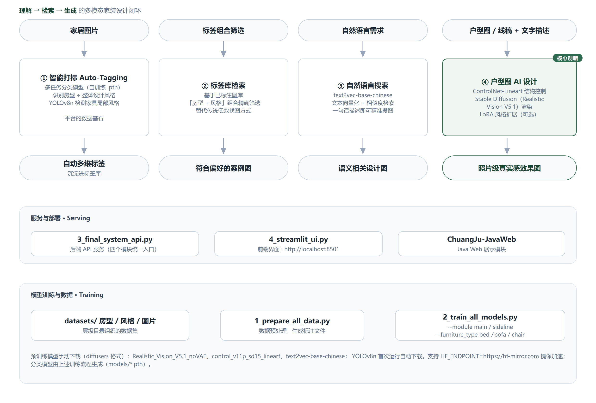

# 创居 AI · ChuangJu — 多模态家装设计平台

打通**理解 → 检索 → 生成**闭环的多模态 AI 家装助手：上传一张家居图即可自动打标，
用「房型 + 风格」组合或一句自然语言找到心仪案例，再把二维户型图 / 线稿加文字描述
直接渲染为照片级真实感效果图。

[English](README.md) | 简体中文

[](https://www.python.org/)
[](https://pytorch.org/)
[](LICENSE)

<p align="center">
  
</p>

## 四大核心模块

| 模块 | 功能 | 核心技术 |
|---|---|---|
| ① **智能打标** | 上传图片自动识别房型、整体设计风格，并检测核心家具及其局部风格 | 多任务分类模型（自训练 `.pth`）+ YOLOv8n 目标检测 |
| ② **标签库检索** | 以「空间类型 + 设计风格」组合精确筛选已标注案例图库 | 结构化标注图库 |
| ③ **自然语言搜索** | 一句日常描述（如"温馨的奶油风卧室"）直接匹配设计图 | text2vec-base-chinese 文本向量化 + 相似度检索 |
| ④ **户型图 AI 设计**（核心创新） | 上传二维户型图 / 线稿 + 文字描述，一键生成与户型结构匹配的照片级效果图 | ControlNet-Lineart + Stable Diffusion（Realistic Vision V5.1）+ 可选 LoRA |

服务层：后端 API（`3_final_system_api.py`）+ Streamlit 前端（`4_streamlit_ui.py`，端口 8501）+ Java Web 展示模块（`ChuangJu-JavaWeb/`）。

## 快速开始

```bash
# 1. 环境（Python 3.9）
conda create --name AI python=3.9 -y && conda activate AI
pip install -r requirements.txt

# PyTorch 2.1.2 + cu118（Windows wheel 方式安装）
pip install torch-2.1.2+cu118-cp39-cp39-win_amd64.whl --no-dependencies --force-reinstall
pip install torchvision-0.16.2+cu118-cp39-cp39-win_amd64.whl --no-dependencies --force-reinstall
pip install torchaudio-2.1.2+cu118-cp39-cp39-win_amd64.whl --no-dependencies --force-reinstall

# 2. 数据与训练（如需重训分类模型）
python 1_prepare_all_data.py                       # 读取 datasets/<房型>/<风格>/*.jpg
python 2_train_all_models.py                       # 训练全部模型
python 2_train_all_models.py --module main         # 仅全局模型（房型 + 整体风格）
python 2_train_all_models.py --module sideline --furniture_type sofa   # 指定家具模型

# 3. 启动
python 3_final_system_api.py        # 终端 1 —— 后端服务
streamlit run 4_streamlit_ui.py     # 终端 2 —— 前端 http://localhost:8501
```

HuggingFace 访问慢请先设置镜像：`$env:HF_ENDPOINT="https://hf-mirror.com"`（Windows）
或 `export HF_ENDPOINT=https://hf-mirror.com`（Linux/Mac）。

### 预训练模型（体积原因不入库，手动下载）

| 模型 | 来源 | 放置目录 |
|---|---|---|
| Stable Diffusion 渲染模型 | [SG161222/Realistic_Vision_V5.1_noVAE](https://huggingface.co/SG161222/Realistic_Vision_V5.1_noVAE)（diffusers 格式） | `realistic-vision-v51/` |
| ControlNet | [lllyasviel/control_v11p_sd15_lineart](https://huggingface.co/lllyasviel/control_v11p_sd15_lineart) | `controlnet-lineart/` |
| 中文语义向量 | [shibing624/text2vec-base-chinese](https://huggingface.co/shibing624/text2vec-base-chinese) | `models/text2vec-base-chinese/` |
| 目标检测 | YOLOv8n | 首次运行自动下载 |
| 全景 LoRA（可选） | HDR360 LoRA | `loras/HDR360.safetensors` |
| 已训练分类模型 | 由上述训练流程生成 | `models/*.pth` |

## 数据集结构

```
datasets/
├── 房间类型1/
│   ├── 风格1/image_01.jpg ...
│   └── 风格2/...
└── 房间类型2/...
```

## 项目结构

```
1_prepare_all_data.py     数据预处理，生成标注文件
2_train_all_models.py     分类模型训练（main / sideline / 单家具）
3_final_system_api.py     后端 API 服务（四个模块统一入口）
4_streamlit_ui.py         Streamlit 前端
models_def.py, config.py  模型与配置定义
ChuangJu-JavaWeb/         Java Web 展示模块
docs/images/              架构图
```

## 说明

- 仓库不含演示截图 / 视频：完整系统需要数 GB 模型权重与 CUDA GPU，
  请按上表完成模型放置后本地运行。
- 分类模型基于自建数据集训练，效果与数据规模和均衡度相关。

## 许可

MIT — 见 [LICENSE](LICENSE)。所引用的第三方预训练模型遵循其各自许可（见上表链接）。

English docs: [README.md](README.md)。
